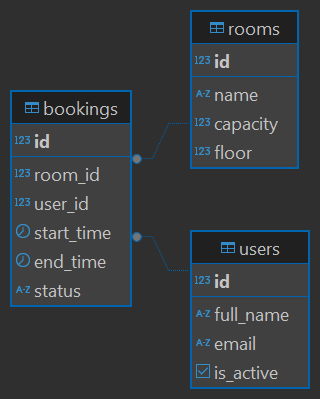

# Система бронирования переговорных комнат

Проект для портфолио системного аналитика.

## Задача проекта
Разработать логическую и физическую модель данных для сервиса, позволяющего сотрудникам бронировать переговорные комнаты, а также описать ключевые бизнес-процессы.

## Стек и инструменты
*   **СУБД:** PostgreSQL 17
*   **Инструмент:** DBeaver
*   **Язык:** SQL

## Структура репозитория
*   `schema.sql` — DDL-скрипт для создания структуры базы данных.
*   `seed_data.sql` — скрипт для наполнения базы тестовыми данными.
*   `queries.sql` — набор SQL-запросов для проверки бизнес-логики.

## Реализованная модель данных
В базе данных реализованы 3 сущности: `users`, `rooms` и `bookings`. 
На уровне БД заложены бизнес-правила: запрет на создание брони, где время окончания раньше времени начала, и ограничение статусов (`created`, `confirmed`, `cancelled`).

